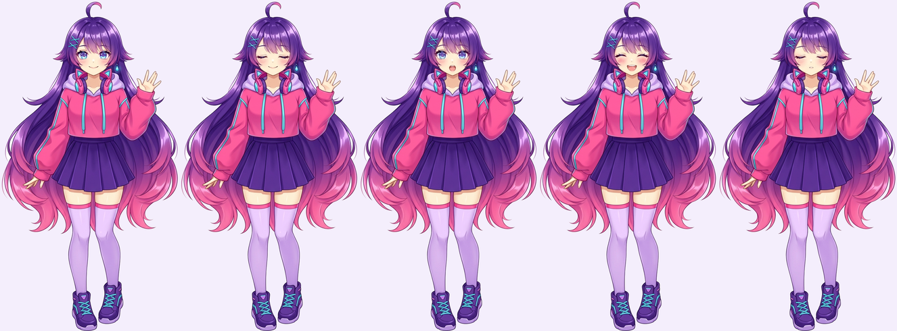

# Akemi — aparência base



Esta é a **aparência base** da Akemi, no estilo de modelo de VTuber: anime 2D
com acabamento de volume (gradientes suaves, brilhos, luz de contorno), mas
sem ser 3D.

> **Sobre a arte:** estas imagens foram geradas por IA (Nano Banana, pelo
> Higgsfield) só para **mostrar como é a aparência base** da Akemi. Não são
> uma arte final. O visual está **aberto a mudanças, inclusive drásticas**
> (penteado, roupa, pose, estilo de desenho), desde que as **cores principais**
> abaixo sejam mantidas.

## Paleta (o que não muda)

| Cor | Hex | Papel | Onde aparece hoje |
|---|---|---|---|
| Rosa vibrante | `#FC3B7F` | cor principal | moletom, pontas do cabelo, fone |
| Roxo profundo | `#5420A8` | contraste | cabelo, saia, tênis |
| Azul-ciano | `#42D9E8` | detalhes e acessórios | olhos, presilhas, cordões, pingente, cadarços |
| Lilás pastel | `#E9D5FF` | suavidade | forro do capuz, meias, brilho do cabelo |
| Creme | `#FFF1E6` | partes neutras | pele |

## Elementos da base

- Cabelo bem longo em degradê, do roxo ao rosa nas pontas, com um fio
  arrepiado no topo
- Olhos grandes em ciano com reflexos
- Duas presilhas ciano cruzadas na franja e um pingente em gota
- Moletom rosa curto com capuz lilás, cordões e friso em ciano
- Fone com orelhinhas de gato no pescoço
- Saia roxa pregueada, meias 7/8 lilás com faixa rosa e tênis roxo com
  cadarço ciano

## Quadros (skin do avatar)

`parado`, `piscando`, `falando`, `feliz` e `dormindo` são PNGs transparentes,
com os nomes que o avatar procura. Só o rosto muda entre eles: o corpo é o
mesmo pixel a pixel, então a troca de quadro não faz a imagem "pular". Para
usar, coloque no `.env`:

```
AVATAR_SKIN=assets/akemi
```

Se for refazer a arte, mantenha os mesmos nomes, o fundo transparente, o
mesmo enquadramento em todos os quadros e os pés encostados na borda de
baixo da imagem.
